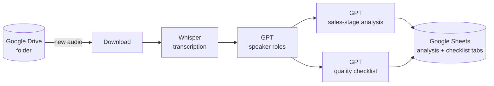

# aiCalls — automated sales-call analysis

A Python port of an n8n workflow that analyses sales calls end to end: new recordings appear in Google Drive, get transcribed, speaker roles are labelled, an LLM reviews the call against the sales process and a quality checklist, and the results land in Google Sheets.

## Pipeline



## What is evaluated

**Sales-process analysis** — summary, who talks most, adaptation to the client's style, the client's name and context, contact establishment, qualification, need identification, presentation, objection handling, closing and next steps.

**Checklist** — stage-by-stage criteria (greeting, contact, needs, presentation, objections, closing) scored per call and written to the checklist sheet.

## Setup

```bash
pip install -r requirements.txt
```

1. Create a Google Cloud project, enable the Drive and Sheets APIs, create a service account and download its JSON key.
2. Share the Drive folder and the target spreadsheet with the service account.
3. Run the script once to generate `config.json`, then fill it in:

```bash
python call_automation.py
```

```json
{
  "openai_api_key": "<your OpenAI key>",
  "google_credentials_path": "<path to service-account.json>",
  "google_drive_folder_id": "<Drive folder id>",
  "spreadsheet_id": "<Google Sheet id>",
  "analysis_sheet_name": "Call analysis",
  "checklist_sheet_name": "Checklist",
  "manager_names": ["Alice"],
  "company_name": "Acme"
}
```

## Files

```
call_automation.py                — the pipeline
CallAutomatizationЛейсан.json     — original n8n workflow export
*.html                            — sheet templates (analysis columns and checklist)
config.json                       — settings (fill in your own values)
```

## Stack

Python, OpenAI API (Whisper + GPT), Google Drive API, Google Sheets (gspread).

A more complete version of this idea — with a database, manager detection and a web dashboard — lives in [voiceAI](https://github.com/Fortuneq/voiceAI).
